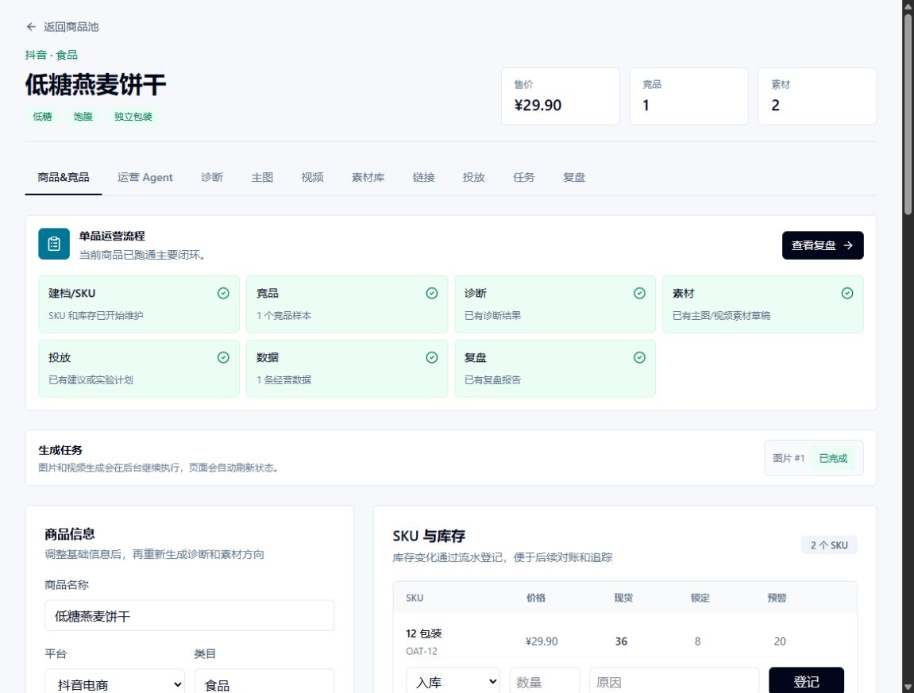
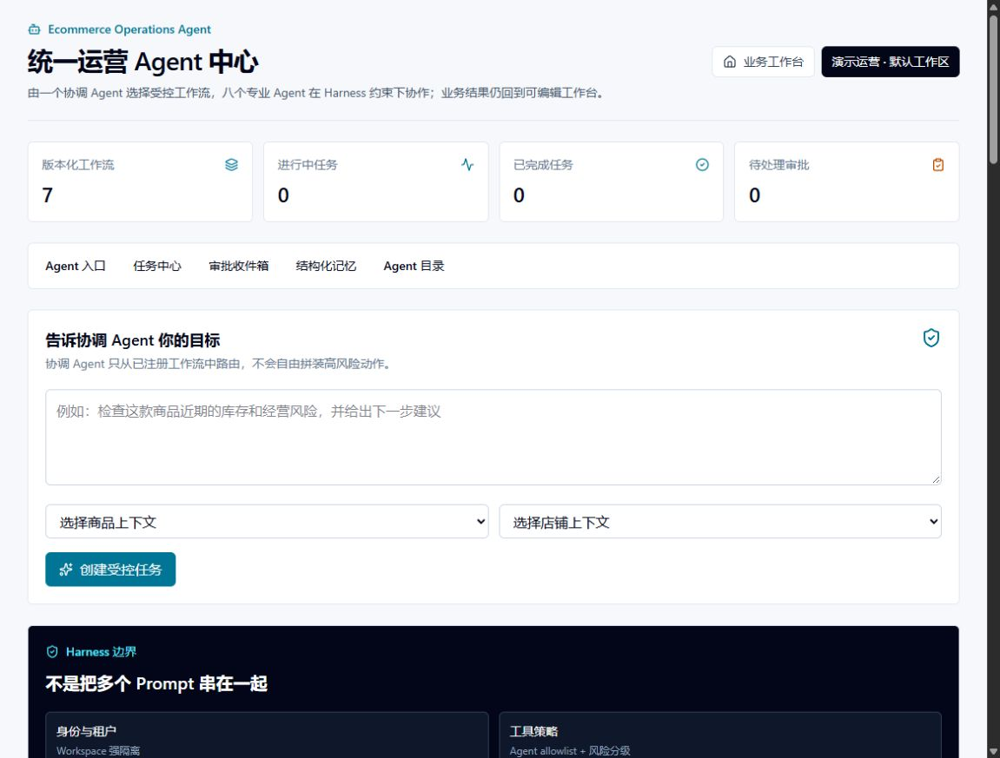
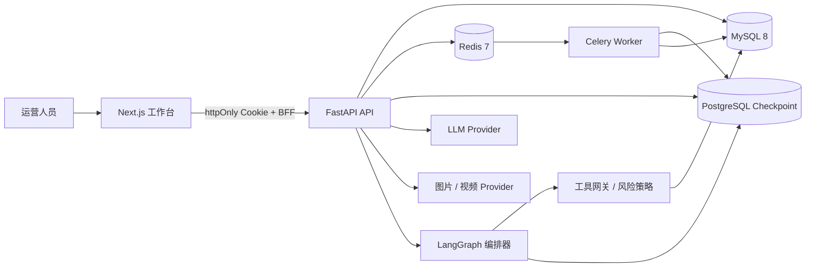
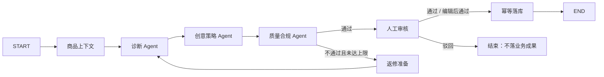

# AI 电商运营助手

> 面向多平台电商团队的单品运营工作台：把商品诊断、竞品分析、创意生产、库存建议、投放实验和经营复盘串成一条可审计、可人工干预的 AI 工作流。


## 项目截图

| 单品运营工作台 | 统一 Agent 中心 |
| --- | --- |
|  |  |

工作台围绕一个商品展示建档、竞品、诊断、素材、投放、数据和复盘状态；Agent 中心把协调 Agent、专业 Agent、工具策略和人工审批集中到一个入口。

## 为什么做这个项目

电商运营的痛点通常不是“缺一个会写文案的模型”，而是：

- 商品、竞品、素材、库存、投放和复盘数据散落在不同表格与平台；
- 大模型输出是一整段不可编辑的文本，无法直接进入业务流程；
- 高风险动作（创建实验、调整库存、发布素材）不能交给模型自动执行；
- 生成任务耗时长，失败后需要重试，Agent 中断后需要恢复；
- 多店铺、多成员场景下，数据隔离和权限边界必须由后端保证。

这个项目用 **FastAPI + LangGraph + Celery + Next.js** 把上述问题收敛成一套可运行的工作台：模型负责生成结构化候选，业务系统负责校验、审批、落库和追踪。

## 核心能力

| 模块 | 能力 |
| --- | --- |
| 多平台店铺 | 店铺、平台账号、商品、SKU、库存流水、盘点与库存汇总 |
| 数据导入 | 商品 / SKU 库存 / 经营数据 CSV 预览、校验、幂等落库与模板下载 |
| 商品诊断 | 结合商品与竞品上下文生成结构化诊断、问题归因和优化建议 |
| 竞品分析 | 竞品建档、URL 导入、监控快照与变化分析 |
| 创意生产 | 主图方案、视频脚本、图片 / 视频异步生成、失败重试与取消 |
| 库存运营 | 缺货与积压识别、补货 / 调拨 / 盘点建议，模型不可用时规则兜底 |
| 投放与复盘 | 推广链接、投放建议、实验记录、经营数据与周期复盘报告 |
| Agent 平台 | 7 条版本化工作流、8 个专业 Agent、协调路由、结构化记忆与审批收件箱 |
| 权限与隔离 | Workspace 级数据隔离，Owner / Operator / Viewer 角色权限 |
| 工程交付 | Docker Compose、Alembic 迁移、117 项自动化测试、OpenTelemetry 可选接入 |

## 系统架构



- **前端**：Next.js App Router 负责页面与服务端数据加载，登录 token 只写入 httpOnly Cookie，浏览器脚本不直接持有凭证。
- **后端**：FastAPI 提供 80+ REST 接口，Pydantic 负责请求 / 响应与结构化模型校验，SQLAlchemy + Alembic 管理 MySQL 数据。
- **异步任务**：Celery + Redis 承载图片 / 视频生成、Agent 工作流和定时维护；Outbox 事件保证任务入队与业务状态一致。
- **Agent 编排**：LangGraph 负责节点、条件路由、质量门、人工中断和 checkpoint 恢复；PostgreSQL 保存工作流快照。
- **可观测性**：OpenTelemetry 可选导出链路数据，运行事件与模型用量落库，敏感字段统一脱敏。

## Agent 工作流



平台层还注册了 7 条工作流：商品诊断优化、创意素材生产、竞品持续监控、投放实验闭环、周期经营复盘、库存运营、店铺组合巡检。协调 Agent 只从已注册工作流中路由，不会自由拼接高风险动作。

### 关键设计

- **结构化输出**：诊断、创意方案、复盘和库存建议都要求模型返回 JSON，再经 Pydantic 校验后进入可编辑字段。
- **质量门与有限返修**：质量 Agent 检查结构、重复角度和禁止表达；未通过时最多返修一次，避免无限循环和 token 失控。
- **Human-in-the-loop**：R2 / R3 工作流在关键节点 `interrupt`，审批后从 checkpoint 恢复；编辑后通过会重新跑质量门。
- **工具白名单与风险分级**：每个 Agent 只能调用注册工具，R0–R3 对应只读、草稿、需审批、Owner 专属等策略。
- **异步可靠性**：Celery 任务使用晚确认、worker 丢失重投、租约 fencing、超时清理和幂等落库，避免重复副作用。
- **模型降级**：LLM 未配置或响应不合法时，诊断、创意和库存建议使用规则版结果，保证工作台可用。
- **租户隔离**：Workspace 从认证用户的成员关系解析，商品、店铺、任务、审批和记忆都按 Workspace 收口。

## 技术栈

| 层次 | 技术 |
| --- | --- |
| 前端 | Next.js 16、React 19、TypeScript、Tailwind CSS 4、ECharts、React Hook Form、Zod |
| 后端 | Python 3.12、FastAPI、Pydantic v2、SQLAlchemy 2、Alembic |
| Agent | LangGraph、结构化状态、PostgreSQL Checkpoint、工具网关、固定评测用例 |
| 异步 | Celery 5、Redis、Outbox、任务租约与超时维护 |
| 数据 | MySQL 8、Redis 7、PostgreSQL 16（Agent checkpoint） |
| 模型 | OpenAI-compatible Chat Completions、DashScope 图片 / 视频生成 |
| 交付 | Docker Compose、健康检查、OpenTelemetry、Pytest、Ruff |

## 快速开始

### 方式一：Docker Compose（推荐）

环境要求：Docker Desktop / Docker Engine + Compose v2。

```bash
cp .env.example .env
# Windows PowerShell: Copy-Item .env.example .env
```

至少修改 `.env` 中的数据库与认证密钥：

```dotenv
MYSQL_ROOT_PASSWORD=replace_with_a_random_secret
REDIS_PASSWORD=replace_with_a_random_secret
AGENT_POSTGRES_PASSWORD=replace_with_a_random_secret
AUTH_SECRET_KEY=replace_with_at_least_32_random_chars
```

启动全部服务：

```bash
docker compose up --build -d
docker compose ps
curl http://127.0.0.1:8000/health
```

首次启动后创建登录账号：

```bash
docker compose exec -e BOOTSTRAP_EMAIL=owner@example.com -e BOOTSTRAP_PASSWORD='ChangeMe123!' -e BOOTSTRAP_DISPLAY_NAME='Owner' api python scripts/bootstrap_user.py
```

打开 <http://localhost:3000>，使用上面的邮箱和密码登录。登录后点击 **生成演示数据**，即可体验店铺、商品、SKU、诊断、素材、投放和复盘链路。

> 演示数据全部为虚构内容，不包含真实平台 token、cookie 或订单数据。

### 方式二：本地开发

后端需要 MySQL 8；完整 Agent 工作流还需要 Redis 与 PostgreSQL checkpoint 库。

```bash
cd api
uv venv
# macOS / Linux
source .venv/bin/activate
# Windows PowerShell
# .\.venv\Scripts\Activate.ps1
uv pip install -r requirements.txt
cp .env.example .env
# 按本机环境修改 DATABASE_URL、REDIS_URL、AGENT_CHECKPOINT_* 和模型配置
alembic upgrade head
uvicorn app.main:app --reload --port 8000
```

另开终端启动 worker（使用 Celery 队列时）：

```bash
cd api
celery -A app.worker.celery_app.celery_app worker -l INFO -Q generation,agent,agent.workflow,maintenance -B
```

前端：

```bash
cd web
npm ci
cp .env.example .env.local
npm run dev
```

默认访问 <http://localhost:3000>，前端通过 `NEXT_PUBLIC_API_BASE_URL` 指向 `http://127.0.0.1:8000`。

### 模型配置

在根目录 `.env` 或 `api/.env` 中配置：

```dotenv
LLM_BASE_URL=https://api.deepseek.com
LLM_API_KEY=your_api_key
LLM_MODEL=deepseek-v4-pro

IMAGE_PROVIDER=dashscope
IMAGE_API_KEY=your_api_key
IMAGE_MODEL=wan2.6-t2i

VIDEO_PROVIDER=dashscope
VIDEO_API_KEY=your_api_key
VIDEO_MODEL=wan2.6-t2v
```

不配置模型 Key 也可以体验商品、店铺、SKU、导入、演示数据、规则版诊断和规则版库存建议；图片 / 视频生成和 LLM 创意需要对应供应商凭证。

## 测试与质量

```bash
cd api
uv venv
# macOS / Linux
source .venv/bin/activate
# Windows PowerShell
# .\.venv\Scripts\Activate.ps1
uv pip install -r requirements.txt
python -m pytest -q
# 117 passed
```

```bash
cd web
npm ci
npm run build
# Next.js production build + TypeScript check
```

测试覆盖认证与权限、Workspace 隔离、商品 / 店铺 / SKU、CSV 导入、诊断、素材、生成任务、竞品监控、库存建议、投放实验、复盘、Agent 工作流、审批恢复、策略拒绝和脱敏等场景。`api/evals` 还内置 7 组固定工作流用例与 42 条平台边界用例，覆盖路由、上下文、策略、质量、恢复和审批。

## 项目结构

```text
.
├── api/
│   ├── app/
│   │   ├── agents/          # LangGraph 编排、专业 Agent、策略、评测
│   │   ├── api/routes/      # FastAPI 路由
│   │   ├── core/            # 配置与安全边界
│   │   ├── db/              # 数据库会话
│   │   ├── services/        # 业务服务
│   │   ├── worker/          # Celery 任务
│   │   ├── models.py        # SQLAlchemy 模型
│   │   └── schemas.py       # Pydantic 模型
│   ├── alembic/             # 数据库迁移
│   ├── evals/               # 固定评测用例
│   └── tests/               # 117 项自动化测试
├── web/
│   └── src/
│       ├── app/             # 页面与 BFF route handlers
│       ├── components/      # 业务组件
│       ├── lib/             # API 客户端与会话
│       └── types.ts
├── docs/screenshots/        # README 截图
├── docker-compose.yml
├── docker-compose.offline.yml
└── .env.example
```

## 项目亮点（可用于简历）

- 基于 **LangGraph** 设计 7 条版本化多 Agent 工作流，落地商品上下文、诊断、创意、质量门、人工审核和幂等落库，支持 checkpoint 中断恢复。
- 使用 **FastAPI + MySQL + Redis + Celery** 构建 80+ 接口的运营后端，通过 Outbox、任务租约、幂等键和超时清理保证异步任务可靠性。
- 实现 **结构化输出 + 质量返修 + 人工审批 + 工具白名单 + R0–R3 风险分级**，把大模型能力约束在可审计的业务边界内。
- 搭建 **Next.js 16 + React 19** 工作台，覆盖商品、竞品、素材、库存、投放和复盘全链路，并用 Docker Compose 完成一键交付。
- 建立 **117 项自动化测试 + 49 条固定评测场景**，覆盖权限隔离、失败重试、断点恢复、策略拒绝和敏感字段脱敏。

## 说明

- 项目以电商运营为业务背景，演示数据、店铺和商品均为虚构。
- 图片 / 视频生成与 LLM 调用依赖外部供应商，请自行配置合规的 API Key 并遵守供应商条款。
- 高风险动作默认需要人工审批，系统不会自动执行真实投放、扣费或平台发布。
